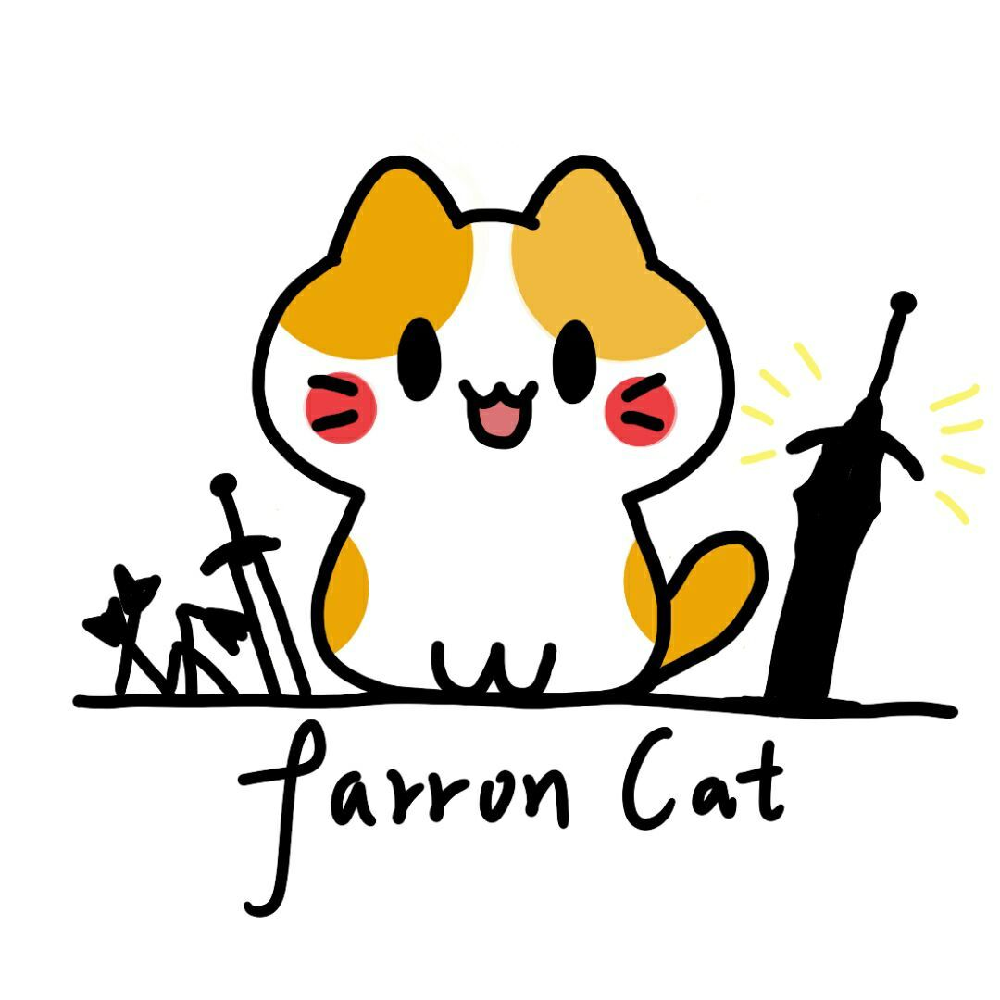

<div align="center">



# farron cat's Blog

**collect all Interests** — 一个记录编程、游戏开发与图形学笔记的个人博客。

[](https://vitepress.dev/)
[](https://vuejs.org/)
[](https://pnpm.io/)
[](https://farron-cat.github.io)

[🌐 在线阅读](https://farron-cat.github.io) · [📝 关于我](docs/about.md) · [🐙 GitHub](https://github.com/farron-cat)

</div>

---

## 📖 项目简介

本站是基于 [VitePress](https://vitepress.dev/) + [Vue 3](https://vuejs.org/) 构建的静态站点，内容以 Markdown 书写，构建产物通过 `gh-pages` 分支发布到 GitHub Pages。

笔记主要围绕三条线展开：

| 方向 | 内容 |
| --- | --- |
| 💻 **编程语言** | C++ 核心要点、STL、Lua |
| 🧱 **数据结构** | 绪论 → 线性表 → 栈队列 → 串 → 树 → 图 → 查找 → 排序，附广义表、并查集 |
| 🎮 **游戏开发** | 引擎概念、OpenGL、SDL2/3、GLM / nlohmann json / spdlog、DirectX、Godot、Unity、Love2D |

## 🗂 目录结构

```text
farron-cat.github.io
├─ bin/
│  └─ autoDeploy.bat          # 一键构建并推送到 gh-pages 分支
├─ docs/                      # 站点根目录（VitePress 的 srcDir）
│  ├─ .vitepress/
│  │  ├─ config.mts           # 站点配置：导航、侧边栏、搜索、页脚
│  │  ├─ theme/
│  │  │  ├─ index.ts          # 基于默认主题的扩展入口
│  │  │  └─ style.css         # 品牌色、首页渐变等样式覆盖
│  │  ├─ cache/               # 构建缓存（已忽略）
│  │  └─ dist/                # 构建产物（已忽略，发布用）
│  ├─ public/                 # 静态资源，原样拷贝到站点根
│  │  └─ farroncat.jpg
│  ├─ index.md                # 首页（layout: home）
│  ├─ about.md                # 关于我
│  ├─ programming/            # 编程相关
│  │  ├─ cpp/                 #   ├─ C++ 要点、STL
│  │  ├─ data_structure/      #   ├─ 数据结构 8 章 + 2 篇扩展
│  │  └─ lua/                 #   └─ Lua（占位）
│  ├─ game_development/       # 游戏开发相关
│  │  ├─ engine-concept/      #   ├─ 引擎架构与平台游戏设计
│  │  ├─ opengl/              #   ├─ GLFW/GLEW、VBO/VAO/EBO、绘制三角形、GLSL
│  │  ├─ sdl/                 #   ├─ SDL2 / SDL3 环境配置
│  │  ├─ other library/       #   ├─ GLM、nlohmann json、spdlog
│  │  ├─ platformer/          #   ├─ 平台游戏引擎核心层
│  │  ├─ dx/                  #   ├─ DirectX 12
│  │  ├─ godot/               #   ├─ Godot 基础概念
│  │  ├─ unity/               #   ├─ Unity（占位）
│  │  └─ love2d/              #   └─ Love2D（占位）
│  └─ other/                  # 杂项（如 Steam 下载中断的处理）
├─ package.json
└─ pnpm-lock.yaml
```

## 🚀 本地开发

环境要求：**Node.js ≥ 18**、**pnpm**。

```bash
# 1. 安装依赖
pnpm install

# 2. 启动本地开发服务器（默认 http://localhost:5173）
pnpm docs:dev

# 3. 生产构建（输出到 docs/.vitepress/dist）
pnpm docs:build

# 4. 本地预览构建结果
pnpm docs:preview
```

## 📦 部署

站点采用 **GitHub Pages 分支发布**：`main` 存放源码，`gh-pages` 存放构建产物。

```bash
# Windows 下一键部署
pnpm deploy:win
```

其内部逻辑（`bin/autoDeploy.bat`）：

```bat
pnpm docs:build                       :: 构建静态站点
cd docs/.vitepress/dist               :: 进入产物目录
git init && git add -A
git commit -m "auto construct blog"
git push -f <repo> main:gh-pages      :: 强制推送到 gh-pages 分支
```

> ⚠️ `git push -f` 会覆盖 `gh-pages` 分支历史，请勿在该分支上手动提交。

## ✍️ 新增一篇文章

1. **新建 Markdown**：在对应分类目录下创建文件，例如 `docs/programming/cpp/pointer.md`。
2. **编写正文**：支持 VitePress 的全部 Markdown 扩展（代码块高亮、提示容器、Vue 组件等）。

   ```md
   # 指针

   ::: tip 要点
   指针保存的是地址。
   :::
   ```

3. **配置导航**：在 `docs/.vitepress/config.mts` 中把新页面加入 `nav` 或对应的 `sidebar`。
4. **本地预览**：`pnpm docs:dev` 确认页面与链接正常。
5. **发布上线**：`pnpm docs:build` 通过后执行 `pnpm deploy:win`。

## 🧭 内容完成度

| 模块 | 状态 | 备注 |
| --- | --- | --- |
| 数据结构 | ✅ 完整 | 第 1–8 章 + 广义表 + 并查集 |
| OpenGL | 🚧 进行中 | 环境配置、VBO/VAO/EBO、绘制三角形已完成；GLSL 待补 |
| SDL | ✅ 基本完成 | SDL2 / SDL3 安装配置 |
| 其他库 | ✅ 基本完成 | GLM、nlohmann json、spdlog |
| 引擎概念 | 🚧 进行中 | 架构、平台游戏设计、核心层 |
| C++ | 🚧 提纲 | `essence.md` 为要点清单，`stl.md` 待写 |
| DirectX / Godot / Unity / Love2D / Lua | 📝 占位 | 已有入口页，内容待补充 |

## 🎯 Roadmap

- [ ] 补充 `programming/cpp/stl.md`：容器、迭代器、算法
- [ ] 完善 `programming/cpp/essence.md`：为每个要点补上示例
- [ ] 完成 `game_development/opengl/glsl.md`：着色器语言基础
- [ ] 填充 `game_development/dx/index.md`：DirectX 12 渲染管线
- [ ] 补充 Godot / Unity / Love2D 实战笔记
- [ ] 为数据结构章节补回缺失的配图（第 5、6、7 章引用的图片尚未入库）
- [ ] 增加文章标签 / 归档页

## 📄 License

本仓库内容采用 [CC BY-NC-SA 4.0](https://creativecommons.org/licenses/by-nc-sa/4.0/) 许可，代码部分采用 ISC 许可。

---

<div align="center">

Copyright © 2023-2025 [@farron cat](https://github.com/farron-cat)

</div>
